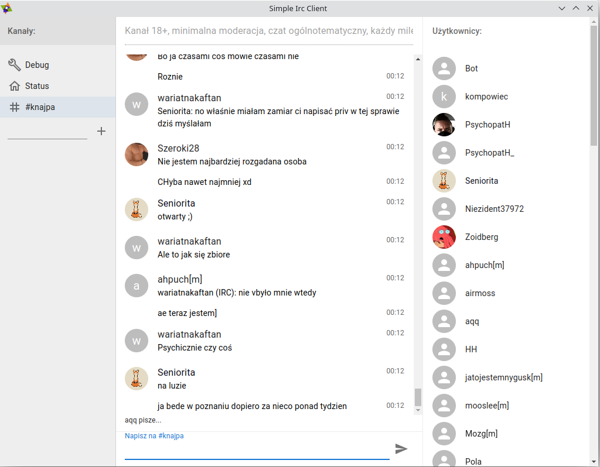

# Simple Irc Client

[](https://github.com/Simple-Irc-Client/desktop/actions/workflows/release-tauri.yml)
[](https://github.com/Simple-Irc-Client/desktop/releases)
[](https://github.com/Simple-Irc-Client/desktop/blob/main/LICENSE)
[](https://github.com/Simple-Irc-Client/desktop/releases)
[](https://tauri.app/)

A simple IRC client for Windows, macOS and Linux. Chat on Libera.Chat, OFTC or any other IRC network, with end-to-end encrypted private messages.

Don't want to install anything? Use the [web chat](https://app.simpleircclient.com/).



## Download

Get the latest version from [GitHub Releases](https://github.com/Simple-Irc-Client/desktop/releases). The app updates itself.

- **Windows** 10 or later
- **macOS** 12 (Monterey) or later
- **Linux**: needs `libwebkit2gtk-4.1-0`, already there on Ubuntu 24.04+, Debian 12+, Fedora 40+ and Arch. Elsewhere:

  ```bash
  sudo apt install libwebkit2gtk-4.1-0   # Ubuntu 22.04
  sudo dnf install webkit2gtk4.1         # Fedora-based
  ```

## Building from source

The desktop app is a [Tauri v2](https://tauri.app/) shell that hosts the React renderer from [`core`](https://github.com/Simple-Irc-Client/core) and links the Rust IRC transport from [`network-rs`](https://github.com/Simple-Irc-Client/network-rs). The IRC protocol itself is handled in `core`.

Layout the three repos as siblings:

```
Simple-Irc-Client/
├── core/        # Vite + React renderer (built to core/dist/)
├── network-rs/  # Rust IRC transport crate (sic-irc)
└── desktop/     # this repo — Tauri shell
```

Prerequisites: Rust, Node 24+, pnpm 11+, plus the [Tauri Linux system deps](https://v2.tauri.app/start/prerequisites/#linux) on Linux.

```bash
# in core/
pnpm install && pnpm build

# in desktop/
pnpm install
pnpm tauri:dev      # dev loop with hot reload
pnpm tauri:build    # produce platform-native bundles
```

### Update signing (release builds only)

Releases are signed with an Ed25519 key so the in-app updater can verify them. When running `pnpm tauri:build` locally and the updater config is enabled, set:

```bash
export TAURI_SIGNING_PRIVATE_KEY="$(cat ~/.tauri/sic.key)"
export TAURI_SIGNING_PRIVATE_KEY_PASSWORD=""
```

To skip updater artifacts entirely (when you don't have the key):

```bash
pnpm tauri build --config '{"bundle":{"createUpdaterArtifacts":false}}'
```

CI publishes signed bundles automatically on tag pushes via `release-tauri.yml`.

### macOS code signing & notarization

When the following repository secrets are set, `release-tauri.yml` signs and notarizes the macOS build. Without them it produces an unsigned `.dmg`.

| Secret | What it is |
|---|---|
| `CERTIFICATE_P12` | Base64 of the "Developer ID Application" `.p12` (cert + private key) |
| `CERTIFICATE_PASSWORD` | Password set when the `.p12` was exported |
| `APPLE_API_KEY_P8` | Base64 of the App Store Connect API `.p8` key file |
| `APPLE_API_KEY_ID` | 10-character Key ID for that `.p8` |
| `APPLE_API_ISSUER_ID` | Issuer UUID from App Store Connect → Users and Access → Integrations |

The workflow decodes `APPLE_API_KEY_P8` to a temp file at runtime and maps the rest into `tauri-action`'s expected env names (`APPLE_CERTIFICATE`, `APPLE_API_KEY`, `APPLE_API_ISSUER`, etc.) — no rename is needed in the GitHub Secrets UI.

## Contributing

Found a bug or have an idea? [Open an issue](https://github.com/Simple-Irc-Client/desktop/issues) or send a pull request.

## License

[AGPL-3.0](LICENSE). Authors: [Piotr Łuczko](https://www.github.com/piotrluczko), [Dariusz Markowicz](https://www.github.com/dmarkowicz).
